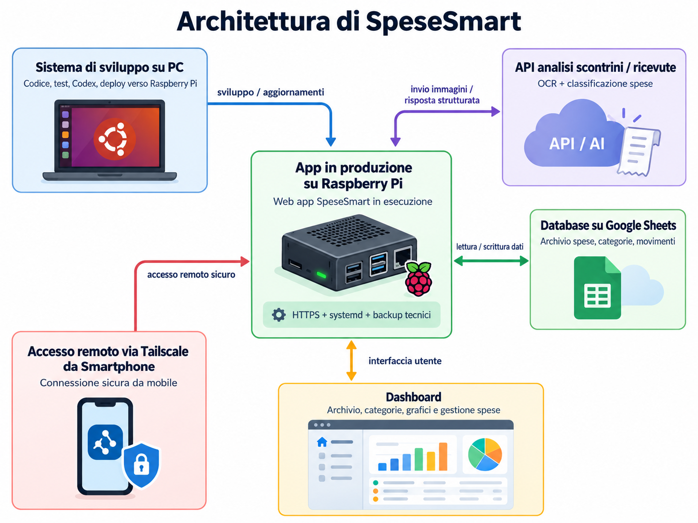

# SpeseSmart

Web app self-hosted in italiano per monitorare e analizzare le spese personali,
con account separati e un archivio Google Sheets condiviso. Il server conserva
le credenziali dei provider; il browser accede attraverso un gateway HTTPS.
Non gestisce entrate, stipendi o saldi bancari.

SpeseSmart è **source-available**: il codice è pubblico e utilizzabile secondo
i termini della [PolyForm Noncommercial 1.0.0](LICENSE). L'uso commerciale
non è autorizzato da questa licenza. Il progetto non è open source in senso OSI.

Il profilo production supporta Raspberry Pi ARM64 con Ubuntu Server, SSD ext4,
HTTPS e account personali. La prima installazione usa esclusivamente credenziali,
certificati e directory del proprietario. OpenAI e Tailscale sono facoltativi.
Il bootstrap e i controlli sono verificati con fixture; il collaudo su hardware
ARM64 e provider propri resta a carico di chi installa.

## 1. Presentazione di SpeseSmart

SpeseSmart organizza acquisti, singoli prodotti e movimenti per categoria.
Ogni account vede le proprie spese e il proprio budget. Il proprietario gestisce
server, foglio Google, chiavi API e backup usando esclusivamente i propri account.
Questa distribuzione non contiene account predefiniti o dati di un'installazione.

## 2. Funzionalità principali

- Inserimento manuale delle spese, anche suddivise in più categorie.
- Analisi degli scontrini con OpenAI, revisione delle righe e conferma esplicita.
  Quantità, sconti, resi e motivazioni delle correzioni restano collegati al documento.
- Controllo della quadratura: il totale ricostruito deve coincidere con quello dichiarato.
- Dashboard responsive: riepilogo mensile, categorie, andamento e acquisti recenti.
- Budget mensile per account, condiviso tra dispositivi nel profilo multiutente;
  residuo negativo ammesso. Default 2.000 €, distinto dai limiti di consumo AI.
- Archivio con filtri, dettagli, modifica controllata ed eliminazione logica.
- Login/logout, cambio password, ruoli admin/user e preferenze personali.
- 13 categorie ufficiali e categoria tecnica «Da classificare»;
  estensioni condivise aggiungibili dall'amministratore.
- Journal durabile, identificativi stabili e verifica delle scritture su Sheets.
- Backup tecnici, verifiche di integrità e prova di ripristino in directory isolata.

Gli screenshot degli acquisti online usano un'estrazione **simulata**.
Le demo non sono analisi reali né dati da importare nel foglio.
Importazione/reset della sessione non cancellano le celle remote; i relativi
strumenti amministrativi non sono esposti dal gateway operativo.

## 3. Architettura del sistema



L'immagine illustra l'architettura di riferimento e **non una specifica
installazione attualmente attiva**.

- **PC Ubuntu:** sviluppo, test e manutenzione tramite Codex, con distribuzione via SSH.
- **Raspberry Pi:** server Next.js in produzione, HTTPS, autenticazione, journal e backup tecnici.
- **Google Sheets:** archivio condiviso con isolamento dei movimenti tramite `UtenteID`.
- **API OpenAI:** analisi di scontrini e ricevute e classificazione delle spese.
- **Tailscale:** accesso remoto privato da smartphone, senza esporre pubblicamente il server.
- **Dashboard:** interfaccia responsive per spese, prodotti, categorie, statistiche e budget personali.

Il gateway convalida TLS, Host, Origin, sessione e CSRF. Next ascolta soltanto
su loopback; capability e prova runtime autorizzano il canale interno.
`UtenteID` viene assegnato dal server, mai accettato dal client.
Un solo writer finanziario deve essere attivo: il lock locale non coordina
macchine diverse o editor esterni del foglio e non offre atomicità distribuita.

## 4. Tecnologie utilizzate

Next.js App Router 16.4, React 19.3, TypeScript, Tailwind CSS 4, Node.js,
Zod, Sharp, SDK OpenAI e client Google Sheets. Le versioni risolte sono in
`package-lock.json`; gli script di gestione sono in `scripts/`.
Le sessioni risiedono in memoria, gli account in un registro privato con scrypt.
Non è richiesto un database SQL aggiuntivo.

## 5. Requisiti software e hardware

- Linux; Node.js **22 o successivo**, npm, Git, OpenSSL, util-linux (`flock`,
  `findmnt`, `lsblk`), iproute2 e Python 3 per il coordinatore backup.
- Il servizio systemd d'esempio e il suo preflight richiedono **Node 24**.
- Profilo Pi: Linux ARM64 e SSD ext4 dedicato; mount e UUID configurabili.
  Applicazione in `MOUNT/app`, dati in `MOUNT/data`; nessun fallback alla microSD.
- Spazio per dipendenze, build, journal e backup. La verifica password scrypt
  richiede circa 128 MiB per operazione: dimensionare la RAM anche per Next e build.
  Non è stato certificato un minimo hardware generale.
- Account Google proprio, Google Sheets API abilitata e service account dedicato;
  chiave OpenAI facoltativa per l'analisi reale. Accesso Internet dal server ai provider.
- Browser aggiornato; HTTPS attendibile per l'uso della fotocamera da smartphone.
  Chrome è richiesto soltanto per i test browser opzionali.

## 6. Installazione e configurazione

### Prima installazione su Ubuntu Server ARM64

Questi comandi sono per una **nuova installazione sul proprio server**. Gli esempi
usano l'utente `spesesmart` e `/srv/spesesmart`; entrambi sono configurabili.
Non trasferire account, journal o ledger da altre installazioni.

1. Installare gli strumenti, creare l'utente dedicato e montare il proprio SSD
   ext4 tramite UUID in `/etc/fstab`. Il mount deve esistere prima delle directory:

   ```sh
   sudo apt update
   sudo apt install -y curl xz-utils ca-certificates git openssl util-linux iproute2 python3 ripgrep nano
   sudo adduser --disabled-password --gecos '' spesesmart
   lsblk -f
   # Inserire in /etc/fstab una riga con il PROPRIO UUID, senza formattare il disco:
   # UUID=UUID_SSD /srv/spesesmart ext4 defaults,nosuid,nodev 0 2
   sudo mkdir -p /srv/spesesmart
   sudo mount /srv/spesesmart
   findmnt -M /srv/spesesmart -o TARGET,FSTYPE,UUID,OPTIONS
   sudo install -d -m 0755 -o spesesmart -g spesesmart /srv/spesesmart/app
   sudo install -d -m 0700 -o spesesmart -g spesesmart /srv/spesesmart/data
   sudo install -d -m 0700 -o spesesmart -g spesesmart /srv/spesesmart/data/credentials /srv/spesesmart/tls
   sudo -iu spesesmart
   umask 077
   ```

   Copiare il codice pubblico in `/srv/spesesmart/app` (anche da un archivio
   sorgente). Installare **Node 24 ARM64** per questo utente; ad esempio, per una
   versione fissata, con checksum dell'archivio ufficiale:

   ```sh
   mkdir -p "$HOME/download-node" "$HOME/.local/node24"
   cd "$HOME/download-node"
   NODE_VERSION=24.18.0
   curl -fSLO "https://nodejs.org/dist/v$NODE_VERSION/node-v$NODE_VERSION-linux-arm64.tar.xz"
   curl -fSLO "https://nodejs.org/dist/v$NODE_VERSION/SHASUMS256.txt"
   rg " node-v$NODE_VERSION-linux-arm64.tar.xz$" SHASUMS256.txt > archive.sha256
   sha256sum -c archive.sha256
   tar -xJf "node-v$NODE_VERSION-linux-arm64.tar.xz" --strip-components=1 -C "$HOME/.local/node24"
   export PATH="$HOME/.local/node24/bin:$PATH"
   node --version
   cd /srv/spesesmart/app
   npm ci
   npm run build
   ```

   Installazione e build devono avvenire sulla
   piattaforma di destinazione: non copiare dipendenze o build x86_64 sulla Pi.

2. Riservare un IP LAN stabile nel router. Preparare HTTPS seguendo i comandi in
   [https-ca-privata-raspberry.md](docs/https-ca-privata-raspberry.md): CA privata
   separata dal server, certificato server di 90 giorni, SAN con il proprio IP.
   Installare i tre file in una directory reale 0700, ad esempio
   `/srv/spesesmart/tls/current`, con file 0600 dell'utente dedicato.

3. Creare la configurazione locale da [pi-config.example.json](docs/pi-config.example.json).
   Sostituire UUID SSD, IP, impronta CA completa e percorso assoluto di Node
   (`command -v node`, nell'esempio `/home/spesesmart/.local/node24/bin/node`).
   Il file non contiene segreti e viene custodito da root. Da un terminale admin:

   ```sh
   sudo install -d -m 0755 /etc/spesesmart
   sudo install -m 0644 /srv/spesesmart/app/docs/pi-config.example.json /etc/spesesmart/pi.json
   sudoedit /etc/spesesmart/pi.json
   ```

   Tornare al terminale dell'utente `spesesmart` e generare il file privato:

   ```sh
   export SPESESMART_PI_CONFIG=/etc/spesesmart/pi.json
   npm run pi:install -- env
   nano /srv/spesesmart/data/production.env
   ```

   Il comando rifiuta un file già presente. Completare `GOOGLE_SHEETS_SPREADSHEET_ID`
   e copiare il proprio JSON service account in
   `/srv/spesesmart/data/credentials/google.json`, permessi 0600. Preparare il
   foglio nuovo come nella sezione 7. Lasciare `OPENAI_API_KEY` vuota per usare
   l'inserimento manuale senza AI. Il file generato attiva il profilo multiutente.
   Non creare file `.env*` nel repository, non usare `source production.env`.

4. Inizializzare lo stato **una sola volta**, poi creare il proprio amministratore:

   ```sh
   npm run pi:install -- init
   node --env-file=/srv/spesesmart/data/production.env scripts/accounts.mjs create amministratore admin
   npm run operational:enable-pi
   ```

   La password è richiesta due volte con input nascosto. Alla conferma della policy
   dichiarare che nessun altro host scrive sul foglio: per una nuova installazione
   non esiste un writer precedente. Il bootstrap crea account vuoti, preferenze,
   journal, ledger AI (anche senza chiave API) e una coppia RSA per cifrare i backup
   account. Custodire una copia della chiave privata di recupero su un supporto
   separato e protetto; non inserirla nel repository.
   `installation.json` viene scritto prima dei registri: una seconda esecuzione,
   anche dopo una perdita di dati o un errore parziale, è bloccata. In quel caso
   esaminare lo stato e ripristinare da backup, senza reinizializzare i registri.

5. Verificare e avviare dal terminale dell'utente dedicato:

   ```sh
   node --conditions=react-server --import tsx scripts/pi-service-check.mts
   npm run pi:production
   ```

   Il preflight è offline; l'avvio non importa dati e non ripete mutazioni pendenti.
   Aprire `https://IP_CONFIGURATO:3443`, dopo aver installato e verificato la CA
   pubblica sul dispositivo, ed effettuare il login. Il primo archivio è vuoto.
   Fermare con Ctrl+C e attendere il drain prima di passare a systemd.
   Next rimane su `127.0.0.1:3444`; non usare `npm start` per l'accesso LAN.

6. Generare e ispezionare l'unità, quindi installarla da un terminale admin:

   ```sh
   # Come spesesmart, con SPESESMART_PI_CONFIG esportata:
   npm run --silent pi:install -- service > /tmp/spesesmart-pi.service
   cat /tmp/spesesmart-pi.service
   # Come amministratore, dopo la verifica:
   sudo install -m 0644 /tmp/spesesmart-pi.service /etc/systemd/system/spesesmart-pi.service
   sudo systemd-analyze verify /etc/systemd/system/spesesmart-pi.service
   sudo systemctl daemon-reload
   sudo systemctl enable --now spesesmart-pi.service
   sudo systemctl status spesesmart-pi.service
   sudo journalctl -u spesesmart-pi.service -n 50 --no-pager
   ```

   Il generatore non installa né avvia servizi. Configurazione e directory devono
   rimanere leggibili/private per lo stesso utente. L'unità vincola il mount SSD,
   conserva hardening, preflight e tempo di arresto. Per modificare mount, utente
   o Node rigenerare l'unità; per cambiare IP occorre anche riemettere il certificato.
   Per aggiornare il codice fermare il servizio, eseguire `npm ci` e build nativa,
   poi riavviare con gli stessi dati persistenti.

### Collaudo degli account su Linux x86_64, senza provider

Usare un utente di sistema e directory nuove, distinti da qualsiasi installazione
preesistente. I comandi seguenti creano esclusivamente stato locale di collaudo:

```sh
export SPESESMART_ACCOUNT_DIR="$HOME/.local/share/spesesmart-demo/accounts"
export SPESESMART_PREFERENCES_DIR="$HOME/.local/share/spesesmart-demo/preferences"
export SPESESMART_SHEETS_UPDATE_DIR="$HOME/.local/share/spesesmart-demo/sheets-updates"
export SPESESMART_AI_DATA_DIR="$HOME/.local/share/spesesmart-demo/ai"
export SPESESMART_LAN_DIR="$HOME/.local/share/spesesmart-demo/lan"
export GOOGLE_SHEETS_SPREADSHEET_ID=synthetic-preview-sheet
npm run accounts -- init
npm run accounts -- create amministratore admin
npm run init:preferences
npm run init:ai
npm run lan:setup
npm run lan:accounts
```

Le password sono richieste nel terminale, mai negli argomenti. `lan:setup`
prepara TLS locale e credenziali LAN; nel collaudo account il login personale
sostituisce Basic. Verificare indipendentemente l'impronta del certificato prima
di inserire password. Non disabilitare la verifica TLS.
`lan:accounts` avvia Next development dietro HTTPS sull'IP fisico rilevato,
elimina le credenziali provider dall'ambiente figlio e disabilita le scritture.
Serve a verificare login e interfaccia: **non abilita un archivio Google reale**.
Su ARM64 il launcher indirizza al profilo `pi:production`.

### Verifiche di sviluppo

```sh
npm run typecheck
npm run lint
npm test
```

I test usano fixture e trasporti simulati. I test browser sono separati:
alcuni script di collaudo operativo effettuano letture reali e vanno eseguiti
solo consapevolmente sul proprio ambiente. Non usare dati reali per test automatici.
Le regole per contribuire sono in [AGENTS.md](AGENTS.md).

## 7. Configurazione Google Sheets e OpenAI

### Google Sheets

1. Nel proprio progetto Google abilitare Sheets API e creare un service account.
2. Creare un **nuovo foglio personale**, condividerlo con l'email del proprio
   service account (Editor per le scritture) e conservare il JSON credenziali
   fuori dal repository, 0600 in directory 0700.
3. Impostare `GOOGLE_SHEETS_SPREADSHEET_ID` e `GOOGLE_APPLICATION_CREDENTIALS`
   nel file privato server. `GOOGLE_SERVICE_ACCOUNT_JSON` è l'alternativa
   server-side e ha precedenza: lasciarla vuota se si usa il file.
4. Esportare i CSV locali del modello, senza contattare Google:

   ```sh
   node scripts/sheets-template.mjs /tmp/spesesmart-foglio-nuovo
   ```

   Nel foglio vuoto usare File → Importa → Carica per ciascun CSV, scegliendo
   «Inserisci nuovi fogli». Rinominare ciascuna scheda con il nome del CSV senza
   estensione e rimuovere la scheda vuota predefinita. Creare così le schede `Movimenti`, `Prodotti`, `Documenti`, `Categorie` e `LEGGIMI`.
   I CSV riproducono intestazioni e righe iniziali di
   [google-sheets-template.json](docs/google-sheets-template.json).
   Il modello è generato dalle definizioni del codice e contiene solo struttura
   e categorie. Le schede finanziarie devono essere vuote oltre la prima riga;
   aggiungere colonne fino a BH (60) in Movimenti, Prodotti, Documenti e Categorie
   per il JSON tecnico. Non inserire spese iniziali o righe dimostrative.
5. Con il proprio ambiente configurato, `npm run check:sheets` controlla
   connessione/metadati e `npm run plan:sheets` prepara l'allineamento senza
   applicarlo. Sono letture reali, da eseguire soltanto sul proprio foglio.
   Per usare il file esterno, dal repository eseguire:

   ```sh
   node --env-file=/srv/spesesmart/data/production.env --conditions=react-server --import tsx scripts/check-google-sheets.mts
   node --env-file=/srv/spesesmart/data/production.env --conditions=react-server --import tsx scripts/plan-google-sheets.mts
   ```

   Sul modello appena importato il piano deve riportare `changes: []`.
   `check:sheets` da solo non certifica l'intero schema o la correttezza dei dati.

L'ordine delle colonne è vincolante. `UtenteID` occupa Movimenti M, Prodotti K,
Documenti L, prima di hash, operazione e JSON tecnico. Le righe senza proprietario
non sono adottate da nuovi account. Non importare fogli o backup dell'autore.
`src/lib/categories.ts` e `src/lib/sheets-persistence-model.ts` sono le fonti
autorevoli del modello. Gli importi locali sono euro o centesimi secondo il tipo;
il confine Sheets conserva la convenzione remota delle uscite negative.

### OpenAI

Funzionalità facoltativa: senza chiave restano disponibili inserimento manuale e archivio.
Impostare una chiave propria in `OPENAI_API_KEY`, esclusivamente sul server,
e mantenere `OPENAI_RECEIPT_MODEL=gpt-4.1-mini`, il modello attualmente
ammesso dal controllo costi. L'analisi reale è a pagamento.
Il template riporta tariffe esemplificative: verificarle e aggiornarle in base
al proprio contratto prima dell'uso; non rappresentano un listino aggiornato.
`SPESESMART_AI_MONTHLY_USD` e `SPESESMART_AI_MAX_ANALYSES` limitano il consumo
globale. `npm run init:ai` inizializza esplicitamente un nuovo ledger senza
chiamate OpenAI. Prenotazioni e consumi ignoti non vanno azzerati per sbloccare l'AI.
Le immagini sono temporanee per analisi/revisione e non entrano nei nuovi
documenti o backup; i dati della ricevuta sono inviati al provider per l'analisi.

## 8. Account e gestione multiutente

`SPESESMART_ACCOUNT_DIR` indica il registro privato, esterno al repository.
Sulla Pi usare `node --env-file=/srv/spesesmart/data/production.env scripts/accounts.mjs`
seguito dal sottocomando; `init` è già eseguito dal bootstrap. Negli altri
ambienti esportare `SPESESMART_ACCOUNT_DIR` prima dei comandi seguenti:

```sh
npm run accounts -- init
npm run accounts -- create amministratore admin
npm run accounts -- create utente user
npm run accounts -- password utente
npm run accounts -- disable utente
```

Eseguire `init` solo su directory nuova. Nessun account o password è preinstallato.
Password di 8–256 caratteri su una riga, senza trim; scrypt con salt casuale.
UUID immutabili, sessioni di 30 minuti, cookie Secure/HttpOnly/SameSite=Strict,
CSRF e revoca dopo reset password/disabilitazione. Il cambio password è anche
disponibile nelle Impostazioni. Logout e cambio account eliminano dati e bozze UI.
L'admin gestisce le estensioni del catalogo e non vede le spese altrui.
Il gestore del server e chi accede direttamente a Sheets possono tecnicamente
leggere l'archivio: l'isolamento applicativo non è cifratura per utente.

## 9. Accesso remoto facoltativo con Tailscale

L'accesso remoto è opt-in, soltanto per `pi:production`:
`SPESESMART_PI_TAILSCALE_HOSTNAME` accetta un singolo FQDN della **propria** tailnet.
Se assente non viene aperto l'adattatore. Il percorso implementato è:
smartphone → HTTPS Tailscale Serve → HTTP loopback `127.0.0.1:3445` →
gateway LAN HTTPS con CA pinnata e SAN IP verificato → Next loopback.
La cifratura HTTPS esterna è terminata da Serve; l'HTTP intermedio resta locale.

L'installazione/configurazione Tailscale e Serve è amministrativa e non viene
eseguita dall'app. Dopo aver completato il bootstrap production, verificare una policy
restrittiva per i soli dispositivi/utenti autorizzati e configurare HTTPS per il
proprio hostname. L'autenticazione applicativa resta obbligatoria.
Non sono forniti ACL, nomi o IP di una tailnet personale. Non abilitare Funnel,
port forwarding o accesso Internet pubblico; non disabilitare TLS per l'upstream.

## 10. Backup e sicurezza

I dati durabili risiedono fuori dal codice: account, preferenze, journal, ledger,
cache strutturata, TLS e credenziali. Directory 0700, file 0600, nessun symlink.
Un `.gitignore` aiuta a evitare errori ma non sostituisce il controllo dei file
prima del commit. Non inserire segreti in variabili `NEXT_PUBLIC_*`.

I comandi `backup:init`, `backup:daily`, `backup:weekly`, `backup:verify` e
`backup:restore-test` sono descritti in [backup.md](docs/backup.md).
Il daily tecnico è locale; il weekly legge anche Sheets. Destinazione, mount e
UUID sono propri dell'installazione. I backup richiedono il writer fermo.
Il registro account è incluso soltanto cifrato; la chiave di recupero è separata.
Il ripristino è una prova isolata, non una riscrittura automatica del foglio.

L’unità systemd viene generata dalla configurazione; il timer backup è separato e facoltativo. Non attivare
timer, coordinatore privilegiato o cancellazioni prima di aver verificato la
propria configurazione. Nessun retry cieco per esiti finanziari/AI incerti:
conservare journal e UUID e usare il recupero esplicito.

## 11. Licenza e crediti

**SpeseSmart © 2026 — Sviluppato da Adriano Parracciani (Cyberparra)**

Il progetto è distribuito come **source-available** con licenza
[PolyForm Noncommercial 1.0.0](LICENSE). Il codice è pubblico: uso, modifica e
distribuzione sono consentiti esclusivamente secondo i termini della licenza;
l'uso commerciale non è autorizzato. Questa limitazione distingue il progetto
dall'open source in senso OSI.

[LICENSE](LICENSE) contiene il testo ufficiale integrale e inalterato,
disponibile anche sul [sito PolyForm](https://polyformproject.org/licenses/noncommercial/1.0.0).
L'attribuzione **© 2026 Adriano Parracciani (Cyberparra)** è conservata in
[NOTICE](NOTICE) come `Required Notice:`: mantenerla nelle copie distribuite
secondo la sezione «Notices» della licenza. Preservare anche il credito nel footer.

Grazie ai progetti Next.js, React, TypeScript, Tailwind CSS, Zod e Sharp e agli
SDK dei provider utilizzati. Le dipendenze e i relativi marchi conservano le
proprie licenze e titolarità. L'immagine di architettura è fornita dall'autore.
